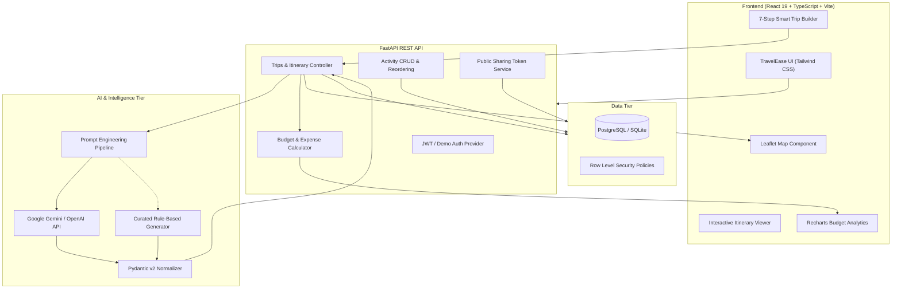

# TravelEase — Personalized Travel Itinerary Planner 🌍✈️

> **Live Demo:** [https://pranshu24-10.github.io/travelItinery/](https://pranshu24-10.github.io/travelItinery/)  
> **GitHub Repository:** [https://github.com/pranshu24-10/travelItinery](https://github.com/pranshu24-10/travelItinery)  

[](https://fastapi.tiangolo.com)
[](https://react.dev)
[](https://www.typescriptlang.org)
[](https://tailwindcss.com)
[](https://supabase.com)
[](https://opensource.org/licenses/MIT)

**TravelEase** is an AI-powered travel planning platform designed to eliminate hours of tedious travel research. It generates structured, day-by-day itineraries complete with attractions, morning/afternoon/evening activity slots, dining options, interactive mapping, transparent budget breakdowns, and local cultural etiquette.

The interface is inspired by the modern **TravelEase UI**, featuring custom typography (`Yesteryear` cursive accent), coral rose brand accents (`#e15c76`), warm off-white canvas, responsive cards, and clean visual hierarchy.

---

## 1. Key Features

- 🧠 **7-Step Smart Trip Builder:** Multi-step wizard covering destination, dates (duration auto-calculated), group configuration, budget & currency, interests, travel pace, and review.
- ⚡ **AI-Powered Itinerary Engine:** Structured JSON generation using Google Gemini / OpenAI with strict Pydantic v2 validation.
- 🛡️ **Curated Fallback Engine:** Works seamlessly out-of-the-box even without an AI API key or when network limits occur.
- 🗺️ **Interactive Leaflet Map:** Pinned attractions, category-coded markers, popup details, and sequential route corridors.
- 📊 **Real-time Budget Analytics:** Visual category donut charts and daily expenditure bar charts built with Recharts, with automated over-budget alerts.
- ✏️ **Full Activity CRUD & Day Regeneration:** Add custom spots, edit timing/costs, reorder activities up/down, or regenerate an individual day with custom AI prompts.
- 🔗 **Secure Public Link Sharing:** Generate read-only public URLs (`/share/:shareToken`) for friends and family without requiring authentication.
- 🖨️ **Print & PDF Export:** Dedicated CSS print styles optimized for portable printed itineraries.
- 🚀 **1-Click Demo Traveler Login:** Instant evaluator access without needing registration.

---

## 2. System Architecture



---

## 3. Technology Stack

### Frontend
- **Framework:** React 19, Vite, TypeScript
- **Styling:** Tailwind CSS v4, Google Fonts (`Yesteryear`, `Plus Jakarta Sans`)
- **Routing:** React Router v7
- **Icons:** Lucide React
- **Charts:** Recharts
- **Maps:** Leaflet & React-Leaflet

### Backend
- **Framework:** Python 3.11+, FastAPI, Uvicorn
- **Data Validation:** Pydantic v2, Pydantic Settings
- **ORM / Database:** SQLAlchemy 2.0 (SQLite for local / Supabase PostgreSQL for production)
- **Security:** Bcrypt password hashing, PyJWT tokens
- **Testing:** Pytest, HTTPX TestClient

---

## 4. Local Quickstart

### Prerequisites
- Node.js 18+ & npm
- Python 3.11+
- Git

### 1. Clone the Repository
```bash
git clone https://github.com/pranshu24-10/travelItinery.git
cd travelItinery
```

### 2. Backend Setup
```bash
# Navigate to backend directory
cd backend

# Create virtual environment
python -m venv venv

# Activate virtual environment
# Windows:
.\venv\Scripts\activate
# macOS/Linux:
# source venv/bin/activate

# Install dependencies
pip install -r requirements.txt

# Start FastAPI development server
python main.py
```
Backend API will start at: `http://localhost:8000`  
Swagger API Docs: `http://localhost:8000/docs`

### 3. Frontend Setup
In a new terminal window:
```bash
# Navigate to frontend directory
cd frontend

# Install dependencies
npm install --legacy-peer-deps

# Start Vite development server
npm run dev
```
Frontend will be live at: `http://localhost:5173`

---

## 5. Automated Tests

All backend health, authentication, trip creation, ownership isolation, day regeneration, and activity CRUD workflows are verified via automated tests:

```bash
cd backend
python -m pytest tests/test_api.py -v
```

**Test Execution Results:**
```
tests/test_api.py::test_health_check PASSED                   [ 14%]
tests/test_api.py::test_user_registration_and_login PASSED    [ 28%]
tests/test_api.py::test_demo_login PASSED                     [ 42%]
tests/test_api.py::test_trip_creation_and_ai_fallback PASSED  [ 57%]
tests/test_api.py::test_trip_ownership_restrictions PASSED    [ 71%]
tests/test_api.py::test_activity_crud_and_sharing PASSED      [ 85%]
tests/test_api.py::test_day_regeneration_and_duplicate PASSED [100%]
======================== 7 passed in 4.48s =========================
```

To run frontend build checks:
```bash
cd frontend
npm run build
```

---

## 6. Environment Variables

Create `.env` in the root and in `backend/`:
```env
PROJECT_NAME="Personalized Travel Itinerary Planner"
SECRET_KEY="super-secret-development-key-change-in-production"
DATABASE_URL="sqlite:///./travel_planner.db"

# Optional AI API keys (Google Gemini / OpenAI)
AI_PROVIDER="gemini"
GEMINI_API_KEY=""
OPENAI_API_KEY=""
```

Create `frontend/.env`:
```env
VITE_API_URL="http://127.0.0.1:8000"
```

---

## 7. Mentor Evaluation Guide

1. Open the web application at `http://localhost:5173`.
2. Click **"Demo Account"** in the top navigation bar or on the login page for 1-click access.
3. Click **"Plan Trip"** and test the 7-step wizard (select city, dates, budget, interests).
4. Review the generated daily schedule, explore the interactive Leaflet map, and view the **Budget Analytics** modal for Recharts visualizations.
5. Test activity controls: add a custom spot, click "Regenerate Day", reorder activities, or click **"Share Trip"** to test the public read-only link.

---

## 8. License

This project is licensed under the MIT License — see the [LICENSE](LICENSE) file for details.
