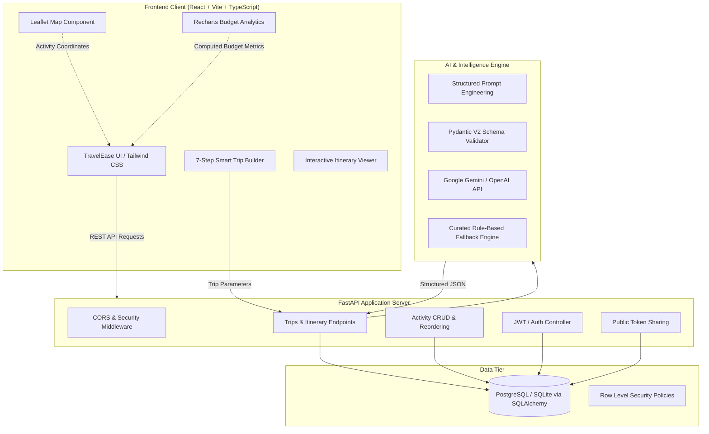
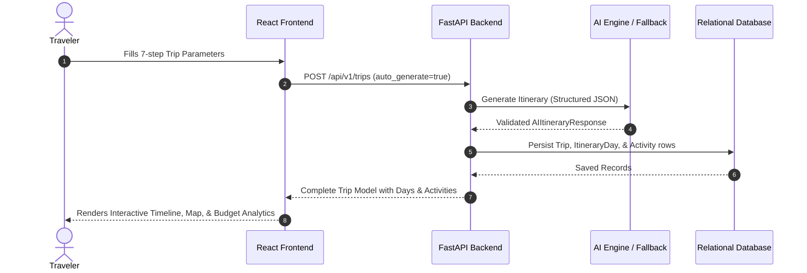

# System Architecture — TravelEase (Personalized Travel Itinerary Planner)

## 1. High-Level Architecture Overview

TravelEase is an enterprise-grade full-stack web application designed for automated, intelligent day-by-day travel planning. The platform utilizes a decoupled client-server architecture with reactive state synchronization, structured JSON schema validation, and persistent relational data storage.

---

## 2. Core Architectural Components

### 2.1 Frontend Tier
- **Framework:** React 19 + TypeScript with Vite for rapid HMR and optimized production bundles.
- **Styling & Design System:** Tailwind CSS styled in the signature TravelEase design system (Yesteryear cursive branding, coral pink `#e15c76` primary accents, emerald tones, rounded cards, and warm off-white canvas `#fcfbfa`).
- **State Management:** React Context (`AuthContext`) with persistent JWT handling.
- **Mapping:** Leaflet & React-Leaflet with custom map pins and sequential walking/transit route corridors.
- **Data Visualization:** Recharts for dynamic donut category distribution and daily spending bar charts.
- **Form Architecture:** Multi-step wizard with step-level validation, dynamic duration calculation, and automated daily budget estimators.

### 2.2 Backend Tier
- **Framework:** Python FastAPI (ASGI) providing high-throughput asynchronous request handling and automated OpenAPI / Swagger documentation (`/docs`).
- **Validation:** Pydantic v2 schemas for strict request/response type safety.
- **ORM:** SQLAlchemy with universal SQLite (local out-of-the-box evaluation) and PostgreSQL (Supabase production) compatibility.
- **Authentication:** Direct bcrypt password hashing and HMAC-SHA256 JWT tokens. Includes instant 1-click Demo Traveler access for mentor evaluation.

### 2.3 AI Prompt & Normalization Pipeline
1. **Prompt Compilation:** Assembles user destination, start/end dates, group configuration, budget ceiling, budget tier, pace, transport modes, and dietary preferences into a strict JSON-forcing prompt.
2. **LLM Invocation:** Calls configured provider (Gemini 1.5 Flash or OpenAI GPT-4o-mini).
3. **Pydantic Validation:** Ingests the raw JSON text and validates against `AIItineraryResponse`.
4. **Resilience & Fallback:** If API keys are absent, network times out, or rate limits occur, the system transparently utilizes the Curated Fallback Intelligence Engine without failing user workflows.

---

## 3. Database Entity Relationship (ERD)

```mermaid
erDiagram
    USERS ||--o{ TRIPS : creates
    TRIPS ||--|{ ITINERARY_DAYS : contains
    ITINERARY_DAYS ||--|{ ACTIVITIES : schedules

    USERS {
        uuid id PK
        string email UK
        string full_name
        string hashed_password
        string preferred_currency
        string preferred_travel_style
        jsonb favorite_interests
        string dietary_preferences
        timestamp created_at
    }

    TRIPS {
        uuid id PK
        uuid user_id FK
        string title
        string destination_city
        string destination_country
        date start_date
        date end_date
        int duration_days
        string traveler_type
        int traveler_count
        numeric total_budget
        string currency
        string budget_tier
        string travel_style
        string accommodation_type
        string transport_mode
        text trip_overview
        text accommodation_recommendations
        jsonb local_tips
        boolean is_favorite
        boolean is_shared
        string share_token UK
        timestamp created_at
    }

    ITINERARY_DAYS {
        uuid id PK
        uuid trip_id FK
        int day_number
        date date
        string theme_title
        text daily_notes
    }

    ACTIVITIES {
        uuid id PK
        uuid day_id FK
        uuid trip_id FK
        string title
        text description
        string time_of_day
        string start_time
        string end_time
        int duration_minutes
        string location_name
        float latitude
        float longitude
        string category
        numeric estimated_cost
        string currency
        string transportation_tip
        int order_index
    }
```

